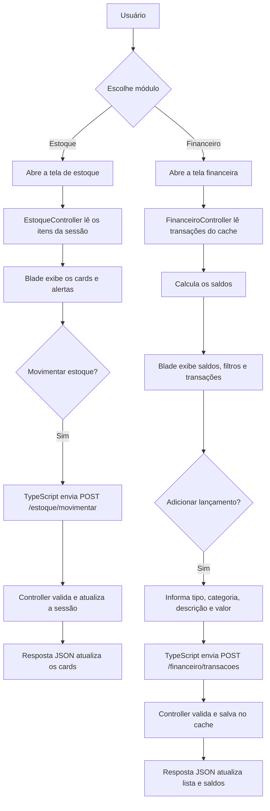
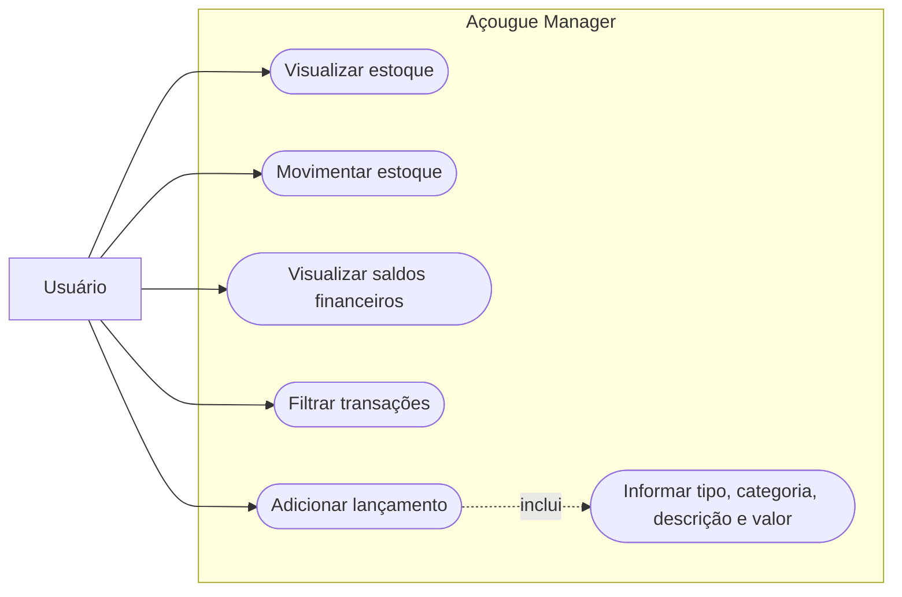
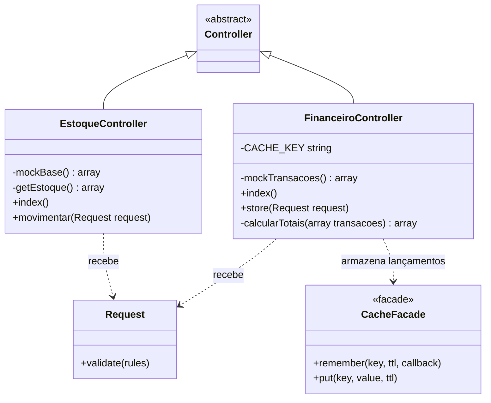

# Como iniciar o Açougue Manager

## Requisitos

- PHP instalado em `C:\Program Files\PHP\current\php.exe`
- Composer
- Node.js e npm

## Preparação inicial

Execute estes passos uma vez, na pasta do projeto, caso ainda não tenham sido feitos:

```powershell
cd "D:\Projeto integrador\acougue-manager"
composer install
Copy-Item .env.example .env
& "C:\Program Files\PHP\current\php.exe" -d extension=mbstring -d extension=openssl artisan key:generate
npm.cmd install
```

Se o arquivo `.env` já existir e a chave da aplicação já tiver sido criada, não repita `Copy-Item` nem `key:generate`.

## Iniciar o servidor

Abra dois terminais PowerShell na pasta do projeto. Deixe os dois abertos enquanto estiver usando o sistema.

No primeiro terminal, inicie o Laravel com as extensões necessárias:

```
powershell
cd "D:\Projeto integrador\acougue-manager"
& "C:\Program Files\PHP\current\php.exe" -d extension=mbstring -d extension=openssl -S 127.0.0.1:8000 -t public public/index.php
```

No segundo terminal, inicie o Vite:

```powershell
cd "D:\Projeto integrador\acougue-manager"
npm.cmd run dev -- --host 127.0.0.1
```

Abra o sistema em <http://127.0.0.1:8000/>. A página inicial redireciona para o estoque. O financeiro fica em <http://127.0.0.1:8000/financeiro>.

Para encerrar, pressione `Ctrl+C` em cada terminal.

## Abrir o diagrama no Mermaid Live

1. Acesse <https://mermaid.live/edit>.
2. Escolha abaixo o diagrama que deseja visualizar e copie somente o código dentro do bloco Mermaid correspondente.
3. No Mermaid Live, substitua o conteúdo do painel esquerdo pelo código copiado.
4. O desenho será atualizado no painel de visualização. Para exportar, use os controles de download do Mermaid Live.

## Diagrama de fluxo do sistema

Este fluxograma mostra o caminho principal das ações nos módulos de Estoque e Financeiro.



## Diagrama de casos de uso

O Mermaid não possui um tipo nativo para diagrama UML de casos de uso. Este fluxograma representa o ator e as funcionalidades de forma aproximada:



## Diagrama de classes

Este diagrama representa as classes PHP implementadas. Os itens de estoque e as transações ainda são arrays mock, não Models Eloquent.


