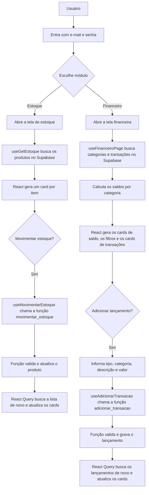
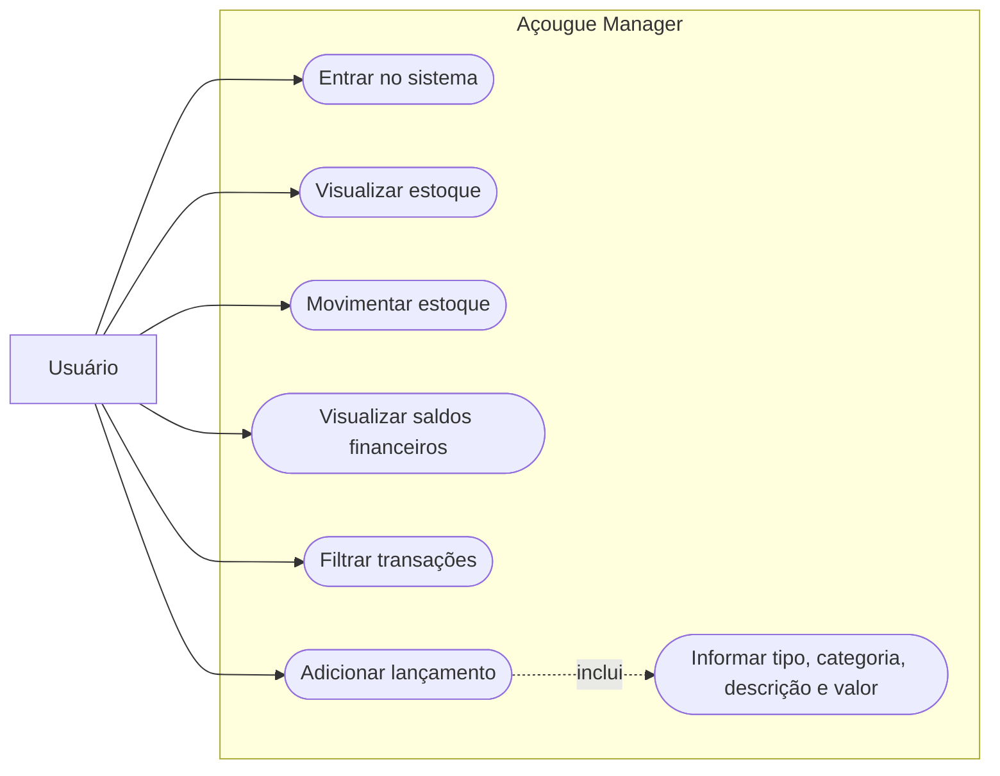
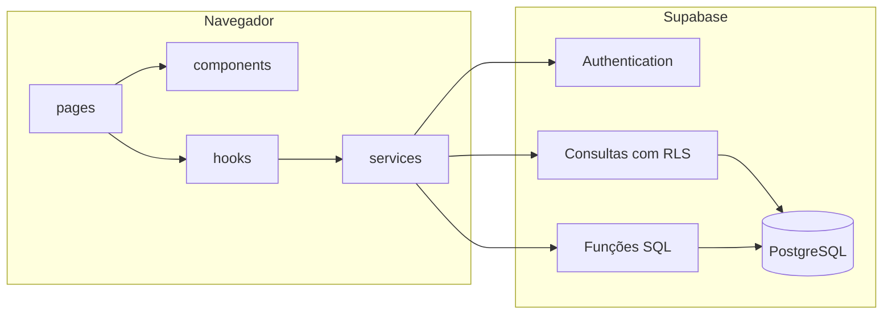

# Como iniciar o Açougue Manager

## Requisitos

- Node.js e npm
- Um projeto no [Supabase](https://supabase.com), de preferência na região South America (São Paulo)

## Preparar o Supabase

Faça estes passos uma vez:

1. No painel do projeto, abra o **SQL Editor** e execute o conteúdo de `supabase/migrations/20261109120000_estrutura_inicial.sql`.
2. Ainda no SQL Editor, execute `supabase/seed.sql` para carregar os dados de exemplo.
3. Em **Authentication → Sign In / Providers**, desative a opção que permite novos cadastros (**Allow new users to sign up**). Sem isso, qualquer pessoa poderia criar uma conta e ver os dados.
4. Em **Authentication → Users**, crie o usuário que vai entrar no sistema.
5. Copie a **URL do projeto** e a **chave pública** (`publishable` ou `anon`) em **Connect** ou **Project Settings → API Keys**.

Nunca use a chave `secret` ou `service_role` no `.env` deste projeto: tudo que começa com `VITE_` fica visível no navegador.

## Preparação inicial

Execute uma vez, na pasta do projeto:

```powershell
cd "D:\Projeto integrador\acougue-manager"
npm.cmd install
Copy-Item .env.example .env
```

Depois, preencha `VITE_SUPABASE_URL` e `VITE_SUPABASE_PUBLISHABLE_KEY` no arquivo `.env`.

## Conferir o Supabase

Este comando só faz consultas e diz o que ainda falta, sem alterar nada no projeto e sem mostrar a chave:

```powershell
npm.cmd run verificar:supabase
```

Ele confere o `.env`, a conexão, o bloqueio de novos cadastros e se as tabelas e funções existem e recusam quem não fez login. Os dados de exemplo e o usuário não aparecem nessa verificação: confira os dois entrando no sistema.

## Iniciar o sistema

```powershell
cd "D:\Projeto integrador\acougue-manager"
npm.cmd run dev -- --host 127.0.0.1
```

Abra o sistema em <http://127.0.0.1:5173/> e entre com o usuário criado no Supabase. Para encerrar, pressione `Ctrl+C` no terminal.

## Abrir o diagrama no Mermaid Live

1. Acesse <https://mermaid.live/edit>.
2. Escolha abaixo o diagrama que deseja visualizar e copie somente o código dentro do bloco Mermaid correspondente.
3. No Mermaid Live, substitua o conteúdo do painel esquerdo pelo código copiado.
4. O desenho será atualizado no painel de visualização. Para exportar, use os controles de download do Mermaid Live.

## Diagrama de fluxo do sistema

Este fluxograma mostra o caminho principal das ações nos módulos de Estoque e Financeiro.



## Diagrama de casos de uso

O Mermaid não possui um tipo nativo para diagrama UML de casos de uso. Este fluxograma representa o ator e as funcionalidades de forma aproximada:



## Diagrama de módulos

Este diagrama representa como as camadas do frontend se ligam ao Supabase.


